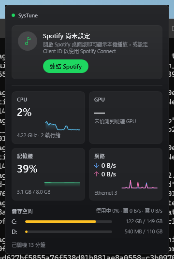
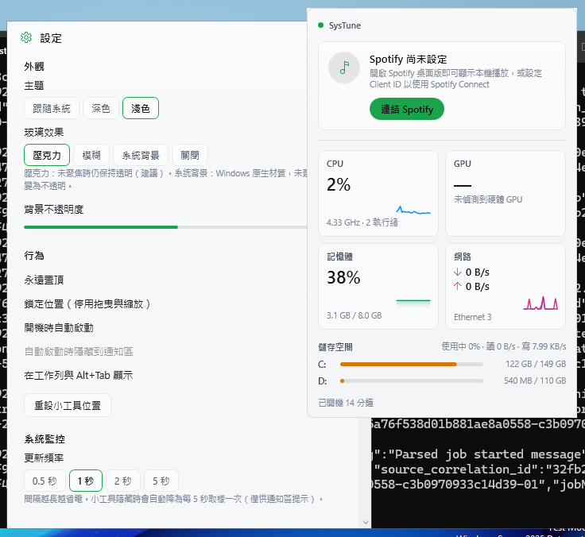
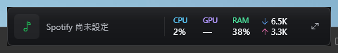

<p align="center"></p>

<h1 align="center">SysTune</h1>

<p align="center">極簡玻璃風格的 Windows 桌面小工具：即時系統監控 × Spotify 播放資訊。</p>

<p align="center">
  Windows 10 (1809+) / Windows 11 · x64 / ARM64 · .NET 10 · WPF
</p>

---

## 功能

**系統監控（真實硬體資料）**
- CPU：使用率、即時時脈、執行緒數、型號；溫度（可取得時）
- GPU：使用率（與工作管理員同源，支援 Intel / AMD / NVIDIA）、型號、VRAM 使用量、溫度（NVIDIA / AMD 免管理員）
- 記憶體：使用量 / 容量、已認可記憶體
- 網路：即時下載 / 上傳速度、目前介面卡、離線偵測
- 儲存空間：各磁碟使用量、整體磁碟活動率與讀寫速度
- 開機時間、筆電電池電量與充電狀態
- 60 秒走勢迷你圖

**Spotify**
- 歌曲、歌手、專輯封面、播放進度（平滑外插，不額外打 API）
- **Spotify Connect**：顯示所有裝置的播放與目前播放裝置；切換裝置、音量、播放/暫停、上下首、拖曳進度、隨機、重複
- **本機模式**：未連結帳戶時，透過 Windows 媒體工作階段直接顯示本機 Spotify 桌面版，免設定
- OAuth PKCE、Token 以 DPAPI 加密；網路斷線、429 限流、授權撤銷都會自動處理，**不影響系統監控**

**桌面小工具**
- 壓克力／模糊玻璃效果、Win11 原生圓角與陰影、深色／淺色／跟隨系統
- 展開模式與精簡膠囊模式（各自記住位置與大小）
- 拖曳移動、右下角等比縮放、永遠置頂、鎖定位置、背景不透明度調整
- 通知區圖示（左鍵顯示/隱藏、右鍵選單、滑鼠停留顯示 CPU/RAM/網速）
- 開機自動啟動（可選擇啟動時隱藏）、設定與視窗位置自動保存
- 多螢幕與每螢幕 DPI（PerMonitorV2）
- 隱藏時自動降載；長時間背景運作的資源用量見 [測試報告](docs/TESTING.md)

## 螢幕截圖

截圖由 CI 在 GitHub Actions 的 Windows Server 2025 Runner 上實際執行 SysTune 自動擷取，顯示的是該虛擬機的真實資料（無 GPU、未連結 Spotify）。詳見 [docs/TESTING.md](docs/TESTING.md)。

| 深色・展開 | 淺色・設定 | 精簡模式 |
| --- | --- | --- |
|  |  |  |

## 安裝

到 [Releases](../../releases) 下載：

- `SysTune-<版本>-win-x64-setup.exe`：安裝版（每使用者安裝，**不需要系統管理員權限**）
- `SysTune-<版本>-win-x64-portable.zip`：可攜版，解壓縮後執行 `SysTune.exe`
- ARM64 裝置請下載 `win-arm64` 版本

兩者皆為 self-contained，不需另外安裝 .NET。執行檔未經程式碼簽章，第一次執行時 SmartScreen 可能顯示警告，請選「其他資訊 → 仍要執行」。可用 `SHA256SUMS.txt` 驗證檔案。

## 使用

| 操作 | 方式 |
| --- | --- |
| 移動 | 在小工具任意空白處拖曳 |
| 縮放 | 拖曳右下角 |
| 精簡 / 展開 | 滑鼠移到標題列 → ⧉ 按鈕；或托盤右鍵選單 |
| 顯示 / 隱藏 | 左鍵點托盤圖示；Esc 隱藏 |
| 播放控制 | 空白鍵播放/暫停、Ctrl+← / → 上/下一首 |
| 設定 | 齒輪按鈕、Ctrl+,、托盤右鍵 |
| 結束 | 托盤右鍵 →「結束 SysTune」（關閉視窗只會隱藏到通知區） |

**連結 Spotify**：請見 [Spotify 帳戶連結指南](docs/SPOTIFY_SETUP.md)。不連結也能使用本機模式。

**CPU 溫度**：CPU 封裝溫度需要「以系統管理員身分執行」並已安裝 [PawnIO](https://pawnio.eu/) 驅動程式（LibreHardwareMonitor 使用的已簽章驅動，SysTune 不會內含或自動安裝任何驅動）；一般權限下若主機板韌體提供 ACPI 熱區，會顯示並在提示中標明來源，否則不顯示（不會顯示假資料）。

## 資料位置

| 內容 | 路徑 |
| --- | --- |
| 設定 | `%APPDATA%\SysTune\settings.json` |
| Spotify Token（DPAPI 加密） | `%LOCALAPPDATA%\SysTune\spotify.token` |
| 記錄檔 | `%LOCALAPPDATA%\SysTune\logs\systune.log` |

解除安裝會移除程式與自動啟動設定，保留上述資料；如需完全清除請刪除這兩個資料夾。

## 從原始碼建置

需要 [.NET 10 SDK](https://dotnet.microsoft.com/download)。

```powershell
dotnet build SysTune.slnx -c Release
dotnet test tests/SysTune.Core.Tests
dotnet run --project src/SysTune.App
# 發布
dotnet publish src/SysTune.App -c Release -r win-x64 --self-contained -o artifacts/publish/win-x64
```

在 Linux / macOS 也能建置（`EnableWindowsTargeting`），但只有 Windows 能執行。安裝檔由 [Release 工作流程](.github/workflows/release.yml) 以 Inno Setup 產生；推送 `v*` 標籤即自動發布。

## 文件

- [架構與技術決策](docs/ARCHITECTURE.md)
- [Spotify 帳戶連結指南](docs/SPOTIFY_SETUP.md)
- [測試策略、結果與已知限制](docs/TESTING.md)
- [版本紀錄](CHANGELOG.md)

## 授權

[MIT](LICENSE)。第三方元件見 [THIRD-PARTY-NOTICES.md](THIRD-PARTY-NOTICES.md)。Spotify 為 Spotify AB 的商標；本專案與 Spotify 無關，僅透過其公開 Web API 運作。
